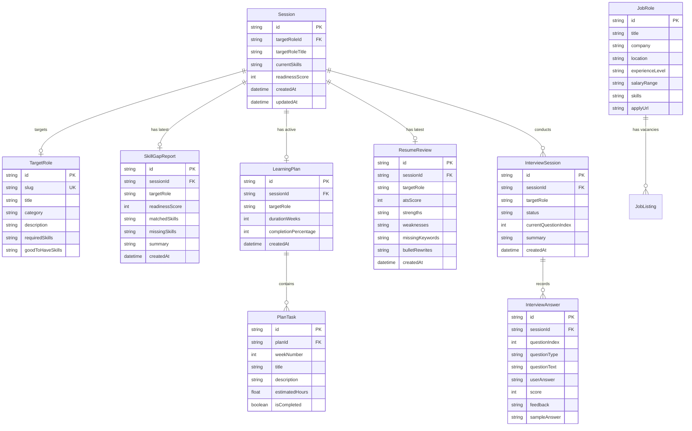

# Data Model: Skill Bridge AI Platform

**Feature**: [Skill Bridge AI Platform](file:///e:/OneMoreTime/projects/CWW%20Ai%20Project/skill-bridge-ai/specs/001-skill-gap-platform/spec.md)
**Date**: 2026-10-17

---

## 1. Entity Relationship Diagram



---

## 2. Prisma Schema Definition (`prisma/schema.prisma`)

```prisma
datasource db {
  provider = "sqlite"
  url      = env("DATABASE_URL")
}

generator client {
  provider = "prisma-client-js"
}

model Session {
  id               String            @id @default(uuid())
  targetRoleId     String?
  targetRoleTitle  String?
  currentSkills    String            @default("[]") // JSON string of string[]
  readinessScore   Int               @default(0)
  createdAt        DateTime          @default(now())
  updatedAt        DateTime          @updatedAt

  targetRole       TargetRole?       @relation(fields: [targetRoleId], references: [id])
  gapReports       SkillGapReport[]
  learningPlans    LearningPlan[]
  resumeReviews    ResumeReview[]
  interviewSessions InterviewSession[]

  @@index([id])
}

model TargetRole {
  id                String    @id @default(uuid())
  slug              String    @unique
  title             String
  category          String    // "Engineering", "Data & AI", "Design", "Product & QA"
  description       String
  requiredSkills    String    // JSON string of string[]
  goodToHaveSkills  String    // JSON string of string[]
  createdAt         DateTime  @default(now())

  sessions          Session[]
}

model SkillGapReport {
  id              String    @id @default(uuid())
  sessionId       String
  targetRole      String
  readinessScore  Int
  matchedSkills   String    // JSON string of string[]
  missingSkills   String    // JSON string of MissingSkillItem[]
  summary         String
  createdAt       DateTime  @default(now())

  session         Session   @relation(fields: [sessionId], references: [id], onDelete: Cascade)

  @@index([sessionId])
}

model LearningPlan {
  id                   String     @id @default(uuid())
  sessionId            String
  targetRole           String
  durationWeeks        Int        @default(4)
  completionPercentage Int        @default(0)
  createdAt            DateTime   @default(now())

  session              Session    @relation(fields: [sessionId], references: [id], onDelete: Cascade)
  tasks                PlanTask[]

  @@index([sessionId])
}

model PlanTask {
  id             String       @id @default(uuid())
  planId         String
  weekNumber     Int
  title          String
  description    String
  estimatedHours Float
  isCompleted    Boolean      @default(false)
  resources      String       @default("[]") // JSON string of LearningResource[]

  plan           LearningPlan @relation(fields: [planId], references: [id], onDelete: Cascade)

  @@index([planId, weekNumber])
}

model ResumeReview {
  id              String    @id @default(uuid())
  sessionId       String
  targetRole      String
  atsScore        Int
  strengths       String    // JSON string of string[]
  weaknesses      String    // JSON string of string[]
  missingKeywords String    // JSON string of string[]
  bulletRewrites  String    // JSON string of BulletRewriteItem[] (exactly 5 items)
  createdAt       DateTime  @default(now())

  session         Session   @relation(fields: [sessionId], references: [id], onDelete: Cascade)

  @@index([sessionId])
}

model InterviewSession {
  id                   String            @id @default(uuid())
  sessionId            String
  targetRole           String
  status               String            @default("in_progress") // "in_progress", "completed"
  currentQuestionIndex Int               @default(0)
  summary              String?           // JSON string of InterviewSummary
  createdAt            DateTime          @default(now())

  session              Session           @relation(fields: [sessionId], references: [id], onDelete: Cascade)
  answers              InterviewAnswer[]

  @@index([sessionId])
}

model InterviewAnswer {
  id                 String           @id @default(uuid())
  interviewSessionId String
  questionIndex      Int
  questionType       String           // "technical", "behavioral"
  questionText       String
  userAnswer         String?
  score              Int?             // 1 to 10
  feedback           String?
  sampleAnswer       String?
  createdAt          DateTime         @default(now())

  interviewSession   InterviewSession @relation(fields: [interviewSessionId], references: [id], onDelete: Cascade)

  @@index([interviewSessionId, questionIndex])
}

model JobRole {
  id              String   @id @default(uuid())
  title           String
  company         String
  location        String
  experienceLevel String   // "Fresher (0-1 yrs)", "Internship", "1-2 yrs"
  salaryRange     String   // e.g. "₹4.5 - ₹6 LPA"
  skills          String   // JSON string of string[]
  applyUrl        String
  createdAt       DateTime @default(now())
}
```

---

## 3. Structured Data Sub-Types (TypeScript & Zod)

### 3.1 MissingSkillItem
```typescript
export interface MissingSkillItem {
  name: string;
  priority: 'High' | 'Medium' | 'Low';
  reason: string;
  category: 'Core Technical' | 'Tool / Framework' | 'Soft Skill / Workflow';
}
```

### 3.2 BulletRewriteItem
```typescript
export interface BulletRewriteItem {
  original: string;
  improved: string;
  rationale: string;
}
```

### 3.3 LearningResource
```typescript
export interface LearningResource {
  title: string;
  url: string;
  type: 'Article' | 'Video' | 'Docs' | 'Course';
  isFree: boolean;
}
```

### 3.4 InterviewSummary
```typescript
export interface InterviewSummary {
  overallRating: number; // 1 to 10
  strengths: string[];
  criticalImprovements: string[];
  readinessVerdict: string;
}
```
